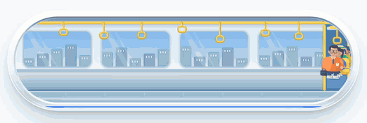

# 用一句提示词，让 Codex 做出胶囊进度条动效

《全员挤进地铁》把地铁车厢变成了一根横向进度条。乘客站稳一位，车厢就多占一格。八个人都上车了，最后一只鞋还在门外，所以进度只能停在 99%。

## 复制这一句

在 Codex 打开一个可写的项目文件夹，粘贴整句即可。要换题材，替换书名号里的主题，角色、道具和卡点按新题材设计。

```text
请在当前目录用 HTML Canvas 做一条《全员挤进地铁》的原创胶囊进度条动画，在浅白色 3:4 画布上用符合主题的横向胶囊外壳装下 8 位造型不同的角色，让他们实际入位才推动进度从 0% 到 100%，安排一次道具引发的连锁反应和一个有明确原因的 99% 卡点，支持自动播放和点击解锁并让约 30 秒的故事自然循环，实际检查手机尺寸、进度与动作同步及首尾衔接，交付离线 HTML、1080×1440 的 60fps 有声和静音 MP4、局部 GIF、封面和可编辑源码 ZIP。
```

预览和文件导出需要 Codex 能写入工作区并运行浏览器与视频编码工具。不同环境生成的美术和剧情细节会有差异，下面是这次实际完成的示例。

## 看成品和试玩



[交互版 HTML](demo.html) · [有声 MP4](metro-rush.mp4) · [静音 MP4](metro-rush-muted.mp4) · [封面](cover.png) · [可编辑源码 ZIP](metro-rush-source.zip)

点开「交互版 HTML」，选 **Download raw file** 下载后用浏览器打开，即可离线播放。也可以在仓库首页用 **Code → Download ZIP** 一次下载所有文件。默认会自动演完整轮。关闭「自动演绎」，等进度停在 **99%** 后点一下车厢，帮最后一位乘客收脚。点「音效」可以听见脚步声、雨伞弹开和关门等声音。完整成片为 **1080×1440，60 fps，约 30.13 秒**，上面的 GIF 裁出了车厢区域。

## 从一句话到交付文件

### 1. 先决定什么东西在填满胶囊

这个案例里，填满车厢的是乘客。车厢用浅蓝色玻璃表现，外面留浅白背景。八位乘客用不同身形、服装和道具分开，黄色巨包、纸杯、长伞、行李箱也是接下来会动起来的东西。换成烤箱，就可以用饼干逐块入盘，每放好一块再增加进度。

### 2. 给 99% 一个看得见的原因

| 时间段 | 画面发生什么 | 进度如何变化 |
| --- | --- | --- |
| 约 0–13 秒 | 乘客进站，巨型背包先卡门，咖啡被碰飞又接住 | 入位后加进度，道具事件会打断登车 |
| 约 13–22 秒 | 雨伞突然撑开，旁边的人跟着挤压和回弹 | 等事件结束后继续登车 |
| 约 22–25 秒 | 人进去了，行李箱堵着门，最后一只鞋伸在外面 | 保持 99%，点击可帮忙，自动演绎也会收脚 |
| 约 25–30 秒 | 鞋弹回车内，关门发车，空车从另一侧返回 | 收脚后到 100%，下一轮回到 0% |

### 3. 把画面和进度接到同一个事件上

源码 ZIP 里有三个主要文件。**改长相和车厢**看 `art.js`，**改人物和登车规则**看 `engine.js`，**改按钮和画布布局**看 `index.html`。

在 `engine.js` 中，`arrive()` 等乘客到位才记录人数，最后一位到位时锁在 99%。`releaseShoe()` 负责让鞋飞回车内并更新到 100%。`wave()` 把冲击按距离延迟传给邻座，所以前后人物会依次晃动。动画按每步 1/60 秒运行，视频画面和音效也可以沿用同一条时间轴。

### 4. 从可以交互的网页导出视频

先在浏览器里确认剧情走通，再以 1080×1440 原始画布逐帧导出，按 60 fps 编成 MP4。示例提供 `window.metroEngine.renderAt(t)` 定位到指定秒数，`advance(n)` 推进固定帧数，`eventLog` 提供音效事件时间。给画面轨合成音效即为有声版，单独保留画面轨即为静音版。裁出车厢生成 GIF，选择 99% 或 100% 的代表帧另存封面。

### 5. 对照成品检查

- 用窄屏打开 HTML，确认整幅 3:4 画面可见，按钮能暂停、重播和切换音效。
- 关掉自动演绎，等它停在 99%，点车厢后看鞋是否收回、进度是否变成 100%。
- 播完一轮后再看开头，确认关门、发车和空车返回衔接连贯。
- 检查两个 MP4 都是 1080×1440、60 fps，有声版有音轨、静音版没有音轨。解压源码后直接打开 `index.html`，检查示例能否独立播放。
